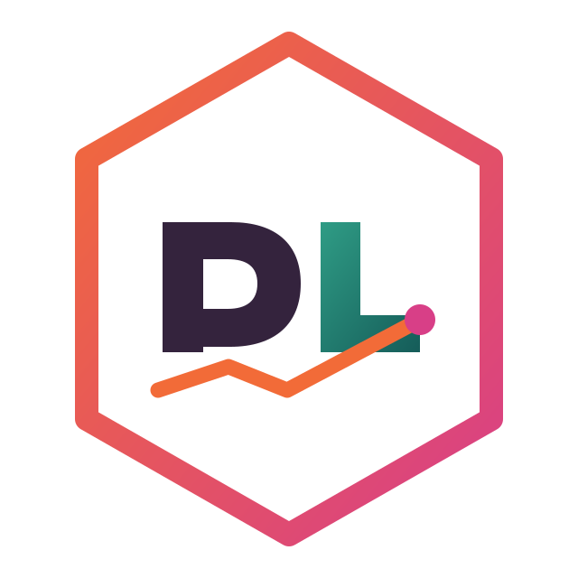
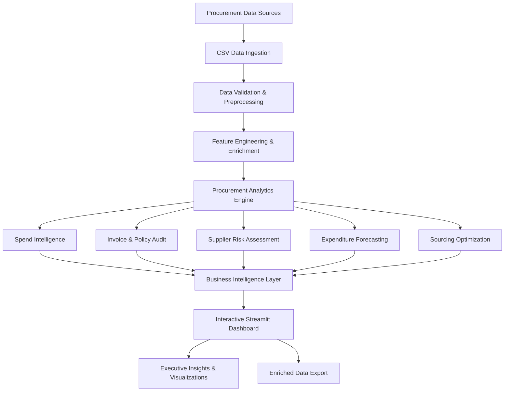
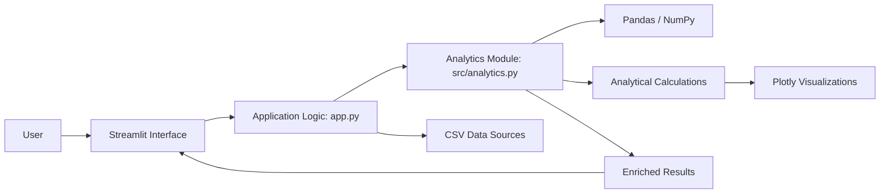
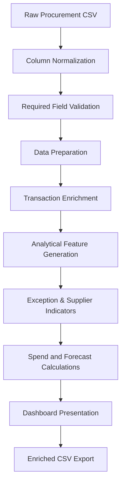
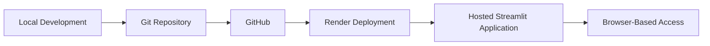

# ProcureIQ AI
### Enterprise Procurement Intelligence, Spend Analytics & Leakage Detection Platform

<p align="center">
  <strong>Turning Procurement Data into Strategic Business Intelligence.</strong>
</p>

<p align="center">
  An interactive enterprise analytics platform designed to uncover spend inefficiencies, identify procurement exceptions, evaluate supplier performance, and support smarter sourcing decisions.
</p>

<p align="center">
  
</p>


---

## 01. Project Overview

**ProcureIQ AI** is an enterprise-oriented procurement intelligence and spend optimization platform developed using Python and Streamlit.

The platform transforms raw procurement transactions into structured business insights through spend analysis, invoice exception screening, supplier risk indicators, expenditure forecasting, and sourcing recommendations.

It brings multiple procurement analytics capabilities together in a unified dashboard, helping users explore financial inefficiencies, identify potential risks, evaluate supplier signals, and make more informed purchasing decisions.

Rather than presenting procurement data as disconnected spreadsheets, ProcureIQ AI creates an interactive decision-support environment that connects financial visibility with operational intelligence.

### Core Capabilities

- **Spend Intelligence:** Explore expenditure across departments, categories, and suppliers.
- **Invoice Auditing:** Identify repeated invoice references and unusual transaction prices.
- **Policy Monitoring:** Surface potentially unauthorized or off-policy purchasing activity.
- **Supplier Intelligence:** Evaluate supplier reliability and observed exception patterns.
- **Expenditure Forecasting:** Generate an indicative six-month spending outlook.
- **Sourcing Optimization:** Compare suppliers and produce a transparent sourcing shortlist.
- **Executive Analytics:** Present procurement performance and priority indicators in one workspace.

---

## 02. Business Problem

Procurement operations generate substantial amounts of financial and operational data. However, fragmented reporting, limited spend visibility, inconsistent supplier monitoring, and manual invoice reviews can make it difficult to identify inefficiencies.

Organizations may encounter challenges such as:

| Business Challenge | Potential Business Impact |
|---|---|
| Limited spend visibility | Difficulty controlling departmental expenditure |
| Repeated invoice references | Potential duplicate-payment exposure |
| Unusual unit prices | Possible overpayment or pricing inconsistencies |
| Off-policy purchasing | Weak procurement compliance |
| Supplier concentration | Increased dependency on individual suppliers |
| Inconsistent supplier performance | Reduced sourcing reliability |
| Limited expenditure planning | Difficulty anticipating future spending |

**ProcureIQ AI addresses these challenges through a unified procurement analytics workflow**, converting transaction-level information into actionable screening indicators and decision-support insights.

---

## 03. System Architecture

ProcureIQ AI follows a modular analytics architecture that separates data ingestion, preprocessing, analytical processing, business logic, and dashboard presentation.

### High-Level Architecture



### Architecture Components

| Layer | Responsibility |
|---|---|
| Data Ingestion | Accept procurement transaction data through CSV uploads and sample datasets |
| Data Processing | Normalize columns, validate fields, and prepare transaction records |
| Feature Engineering | Derive analytical indicators and enrich procurement records |
| Analytics Engine | Perform spend analysis, exception screening, supplier assessment, forecasting, and sourcing comparisons |
| Business Intelligence | Consolidate analytical outputs into decision-support metrics |
| Presentation Layer | Deliver interactive dashboards, charts, tables, and insights |
| Export Layer | Provide enriched analytical data for further exploration |

### Technology Architecture



---

## 04. Seven Integrated Intelligence Workspaces

ProcureIQ AI is organized into seven dedicated workspaces, each addressing a different stage of procurement analysis.

### 01 — Executive Command

A consolidated overview of procurement performance and potential exposure.

**Key capabilities:**
- Total procurement expenditure.
- Transaction and supplier overview.
- Exception and risk indicators.
- Procurement performance summaries.
- Priority investigation queue.
- Executive-level visual insights.

### 02 — Spend Intelligence

Explore how procurement expenditure is distributed throughout the organization.

**Key capabilities:**
- Department-level expenditure analysis.
- Category-wise spend distribution.
- Supplier expenditure comparison.
- Spend concentration analysis.
- Interactive financial visualizations.
- Identification of major spending areas.

### 03 — Invoice & Policy Audit

Screen procurement transactions for potentially problematic invoice and approval patterns.

**Key capabilities:**
- Repeated invoice reference detection.
- Unusual unit-price identification.
- Category-level price anomaly screening.
- Off-policy approval identification.
- Transaction-level risk indicators.
- Exception investigation tables.

### 04 — Supplier Risk

Evaluate supplier-related indicators to support procurement oversight.

**Key capabilities:**
- Supplier performance scorecards.
- Reliability indicator analysis.
- Observed transaction exception rates.
- Supplier comparison.
- Reliability-versus-risk visualization.
- Supplier prioritization insights.

### 05 — Cost Forecasting

Explore indicative future procurement expenditure using historical transaction patterns.

**Key capabilities:**
- Historical expenditure analysis.
- Recent spending baseline.
- Trend-based forecasting.
- Six-month indicative expenditure outlook.
- Forecast visualization.
- Planning-oriented financial insights.

### 06 — Sourcing Optimizer

Generate a supplier shortlist using transparent comparative scoring.

**Key capabilities:**
- Supplier price comparison.
- Reliability-based evaluation.
- Transaction exception consideration.
- Relative supplier scoring.
- Ranked sourcing shortlist.
- Comparative supplier insights.

### 07 — Data Studio

Explore the underlying procurement dataset and its analytical outputs.

**Key capabilities:**
- Dataset preview.
- Data schema inspection.
- Data quality exploration.
- Processed transaction review.
- Enriched dataset export.
- Support for uploaded procurement CSV files.

---

## 05. Data Engineering & Processing Pipeline

The platform follows a structured workflow to transform raw procurement records into analytical outputs.



### Data Processing Stages

1. **Data Ingestion:** Load the included sample dataset or upload a custom CSV file.
2. **Column Normalization:** Standardize column names into lowercase, underscore-separated formats.
3. **Validation:** Check the availability of required procurement fields.
4. **Data Preparation:** Prepare transaction records for downstream analysis.
5. **Feature Engineering:** Derive useful indicators from invoice, price, approval, supplier, and expenditure information.
6. **Analytical Processing:** Calculate spend metrics, exception indicators, supplier scores, and forecast estimates.
7. **Visualization:** Present the processed results through interactive charts and dashboard components.
8. **Export:** Make enriched analytical records available for further examination.

---

## 06. Analytical Methodology

The current portfolio implementation uses explainable analytical techniques and transparent scoring logic.

| Analytical Component | Methodology | Purpose |
|---|---|---|
| Duplicate Invoice Detection | Repeated invoice ID identification | Flag repeated invoice references |
| Price Anomaly Detection | Median Absolute Deviation (MAD) | Identify unusual unit prices within categories |
| Policy Exception Detection | Approval-status rule matching | Surface off-policy or unauthorized approvals |
| Procurement Risk Scoring | Additive screening heuristic | Prioritize potentially exceptional transactions |
| Supplier Health Assessment | Reliability and flagged-record indicators | Compare supplier-related signals |
| Expenditure Forecasting | Recent-average and trend blend | Estimate indicative future expenditure |
| Sourcing Optimization | Relative supplier scoring | Generate a comparative supplier shortlist |

### Important Methodological Notes

**Duplicate Invoice Detection**

Identifies repeated `invoice_id` values in the available transaction dataset. Repeated references require manual verification before being treated as actual duplicate payments.

**Price Anomaly Detection**

Uses a robust median-based deviation approach within procurement categories to identify unusual unit-price observations.

**Policy Exception Detection**

Screens approval-status values for indicators such as off-policy, unauthorized, and exception.

**Supplier Risk Assessment**

Uses an illustrative score based on supplied reliability information and observed flagged-record rates. It is not a validated supplier default or fraud prediction model.

**Expenditure Forecasting**

Combines recent spending averages and trend information to create an indicative six-month expenditure baseline. It is intended for exploratory planning rather than validated financial forecasting.

**Sourcing Optimization**

Uses a transparent comparative score incorporating available reliability, exception, and relative pricing indicators. The resulting shortlist supports exploration and does not automatically award contracts.

---

## 07. Dataset & Data Requirements

### Included Sample Dataset

The repository includes a synthetic procurement dataset:

`sample_data/procurement_transactions.csv`

**Dataset characteristics:**
- 1,800 synthetic procurement transactions.
- Multiple suppliers and purchasing categories.
- Department-level purchasing records.
- Invoice and purchase-related references.
- Transaction quantities and unit prices.
- Approval-status information.
- Seeded repeated invoice references.
- Seeded unusual price observations.
- Seeded off-policy approval examples.

The sample dataset is designed to demonstrate the platform's analytical capabilities. It does not contain real organizational procurement records.

### Required Input Schema

| Column | Description |
|---|---|
| `date` | Transaction date |
| `invoice_id` | Invoice reference |
| `supplier` | Supplier name |
| `department` | Purchasing department |
| `category` | Procurement category |
| `quantity` | Purchased quantity |
| `unit_price` | Price per unit |
| `amount` | Total transaction amount |
| `approval_status` | Procurement approval status |

### Optional Enrichment Fields

- `po_id`
- `supplier_country`
- `supplier_reliability`

Additional fields can provide further context for procurement analysis.

---

## 08. Technology Stack

### Programming & Application Development

- **Python** — Core programming language.
- **Streamlit** — Interactive web application framework.

### Data Processing & Analytics

- **Pandas** — Data manipulation and analysis.
- **NumPy** — Numerical computation.
- **Scikit-learn** — Included in the project environment for potential analytical extensions.

### Visualization

- **Plotly** — Interactive business intelligence visualizations.

### Development & Deployment Tools

- **Visual Studio Code** — Development environment.
- **Git & GitHub** — Version control and repository management.
- **GitHub Desktop** — Graphical Git workflow.
- **Render** — Deployment target and hosting workflow.

---

## 09. Project Development Journey

ProcureIQ AI was developed from the initial business concept into a structured, interactive procurement intelligence application.

### Phase 01 — Business Concept & Problem Definition

- Identified procurement spend leakage and limited spend visibility as core business challenges.
- Defined the platform's focus on invoice exceptions, supplier intelligence, and sourcing decisions.
- Established the objective of creating an integrated procurement decision-support environment.

### Phase 02 — Data Design & Synthetic Dataset Development

- Designed a procurement transaction schema.
- Created a synthetic dataset containing 1,800 records.
- Introduced representative invoice, price, and policy exceptions.
- Prepared the dataset for interactive analysis and demonstration.

### Phase 03 — Analytics Engine Development

- Developed reusable analytics functionality.
- Implemented transaction-level exception screening.
- Added spend and supplier analysis.
- Developed indicative expenditure forecasting.
- Created transparent supplier comparison logic.

### Phase 04 — Streamlit Application Development

- Built the application interface using Streamlit.
- Integrated seven dedicated analytical workspaces.
- Connected data processing with interactive dashboard components.
- Added CSV upload and enriched data export capabilities.

### Phase 05 — User Interface & Experience Design

- Established a distinctive ivory, aubergine, coral, and jade visual identity.
- Designed a premium enterprise-oriented dashboard experience.
- Refined navigation, content hierarchy, visualizations, and interface styling.
- Developed branded application elements and a customized footer.

### Phase 06 — Testing & Refinement

- Worked through application navigation and widget-key issues.
- Refined dashboard state handling.
- Improved file uploader styling and readability.
- Corrected footer rendering and typography.
- Iteratively refined the interface through local Streamlit testing.

### Phase 07 — Repository & Deployment Preparation

- Organized the project into reusable application and analytics modules.
- Prepared the GitHub repository structure.
- Added project documentation, dependencies, and licensing information.
- Prepared the application for a hosted Streamlit deployment workflow.

---

## 10. Installation & Local Execution

### Prerequisites

- Python 3.10 or later.
- Git (optional, for cloning).
- Visual Studio Code or another Python IDE.

### Step 1 — Clone the Repository

```bash
git clone https://github.com/Riyaz077/ProcureIQ_AI.git
cd ProcureIQ_AI
```

### Step 2 — Create a Virtual Environment

```bash
python -m venv .venv
```

### Step 3 — Activate the Environment

**Windows:**

```bash
.venv\Scripts\activate
```

**macOS / Linux:**

```bash
source .venv/bin/activate
```

### Step 4 — Install Dependencies

```bash
python -m pip install --upgrade pip
pip install -r requirements.txt
```

### Step 5 — Launch the Application

```bash
streamlit run app.py
```

Open the local URL displayed in your terminal to access ProcureIQ AI.

---

## 11. Repository Structure

```text
ProcureIQ_AI/
│
├── app.py
│   └── Main Streamlit application and dashboard interface
│
├── requirements.txt
│   └── Python dependencies
│
├── README.md
│   └── Project documentation
│
├── LICENSE
│   └── Project licensing information
│
├── .gitignore
│   └── Git exclusions
│
├── assets/
│   └── procureiq_logo.svg
│       └── Application branding
│
├── sample_data/
│   └── procurement_transactions.csv
│       └── Synthetic procurement transaction dataset
│
├── src/
│   ├── __init__.py
│   └── analytics.py
│       └── Reusable procurement analytics functions
│
└── .streamlit/
    └── config.toml
        └── Streamlit application configuration
```

---

## 12. Deployment

ProcureIQ AI is structured as a Streamlit application and prepared for cloud deployment.

### Deployment Configuration

**Build command:**

```bash
pip install -r requirements.txt
```

**Start command:**

```bash
streamlit run app.py --server.port $PORT --server.address 0.0.0.0
```

### Deployment Workflow



The application can be deployed through a hosting service that supports Python and Streamlit. A live deployment URL should be added here once deployment has been completed and verified.

---

## 13. Responsible Use & Limitations

ProcureIQ AI is a portfolio-level analytical decision-support application.

Its screening indicators are not equivalent to confirmed fraud, financial misconduct, supplier failure, or procurement-policy violations.

- Duplicate references may represent legitimate invoice corrections or other business scenarios.
- Unusual prices may reflect quantity, contract, location, or market differences.
- Supplier scores are illustrative and depend on the quality of available input data.
- Forecast outputs are exploratory estimates and have not been established through formal rolling backtests.
- Sourcing recommendations should not replace procurement, legal, or financial approval processes.

All flagged records should be reviewed against supporting purchase orders, invoices, contracts, delivery records, and organizational policies.

The synthetic dataset must never be represented as real company information or used for actual procurement decisions.

---

## 14. Future Development Roadmap

ProcureIQ AI provides a foundation for a more comprehensive enterprise procurement intelligence ecosystem.

| Enhancement | Planned Capability |
|---|---|
| Database Integration | PostgreSQL-based procurement data warehouse |
| Three-Way Matching | Automated comparison of purchase orders, goods receipts, and invoices |
| Advanced Fraud Analytics | Trained machine-learning models for transaction anomaly detection |
| Supplier Intelligence | Expanded supplier performance and risk indicators |
| Contract Analytics | Contract-price validation and quotation comparison |
| Forecasting | Validated time-series models and rolling backtesting |
| Explainable AI | SHAP-based model interpretation |
| Enterprise Security | Authentication and role-based access control |
| Audit Management | Investigation history and traceable approval workflows |
| Intelligent Automation | Automated exception notifications and procurement workflows |

---

## 15. Project Impact & Value Proposition

ProcureIQ AI demonstrates how data analytics and intelligent decision-support techniques can be applied to enterprise procurement operations.

**Business value areas:**

- Improved visibility into organizational expenditure.
- Earlier identification of potentially exceptional transactions.
- More structured supplier performance comparisons.
- Better understanding of purchasing patterns.
- Data-driven sourcing exploration.
- More accessible procurement intelligence through interactive visualizations.

The platform demonstrates the integration of data engineering, analytical logic, business intelligence, and application development into one cohesive business-focused solution.

---

## 16. Author & Project Information

**Designed, Developed & Documented by**

**Mohamed Riyaz S.**  
Integrated M.Tech – Computer Science and Engineering (Business Analytics)  
Vellore Institute of Technology (VIT), Chennai

**Technical Interests:** Artificial Intelligence | Machine Learning | Data Science | Business Intelligence | Predictive Analytics

<p align="center">
  <a href="https://github.com/Riyaz077">GitHub Profile</a> ·
  <a href="https://www.linkedin.com/in/mohamed-riyaz-s07/">LinkedIn Profile</a>
</p>

---

<p align="center">
  <strong>ProcureIQ AI</strong>
  <br>
  Enterprise Procurement Intelligence & Spend Leakage Detection
  <br><br>
  <em>From raw procurement transactions to actionable business intelligence.</em>
  <br><br>
  © 2026 Mohamed Riyaz S. · All Rights Reserved
</p>

<p align="center">
  <sub>Built with Python · Streamlit · Pandas · NumPy · Plotly</sub>
</p>
